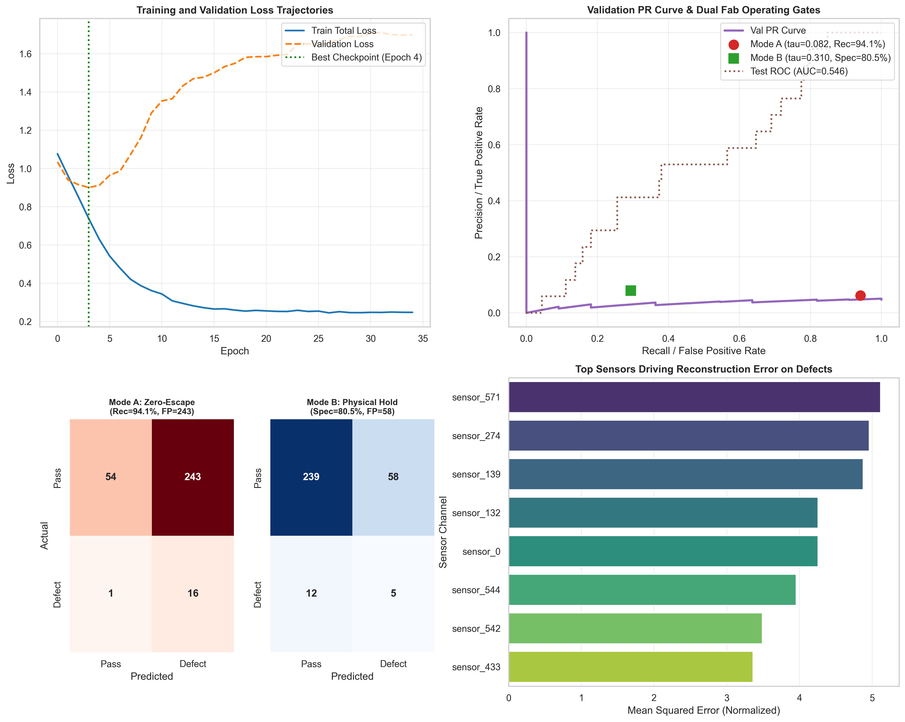

# Wafer Anomaly Detection

**Author:** Shaan Ahamed M

This project audits and repairs a machine learning pipeline for detecting semiconductor wafer defects across 590 manufacturing sensors (`secom_telemetry_modified.csv`).



---

## What Was Broken?

The original notebook (`bnypi.ipynb`) reported an F1 score of 0.9915, but that score was an illusion caused by three silent bugs:

1. **Global SMOTE and Data Leakage:** SMOTE was applied across the entire dataset before splitting, creating an artificial 50/50 balanced test set with duplicated training samples.
2. **PyTorch Tensor Broadcasting:** An input shape mismatch `(batch, 1, features)` vs reconstruction `(batch, features)` caused PyTorch to broadcast into a 3D tensor `(batch, batch, features)`, corrupting reconstruction loss gradients.
3. **Mishandling Legacy Probe Station (PS-L) & Invariant Sensors:** 146 wafers from Legacy Station PS-L had `sensor_0 == 0.0` as a sentinel flag and `sensor_1` holding firmware error codes (`100.0`, `200.0`, `300.0`). Standardizing these numbers produced artificial `-30` sigma outliers. Furthermore, 122 sensors had zero variance in training, and 6 delayed-activation sensors only became active during the test window.

---

## Key Forensic Discoveries

1. **PS-L Defect Rate is 0.00%:** Across all 146 PS-L wafers in the dataset, there are zero defects (0/146), compared to 7.32% (104/1421) on modern probe stations.
2. **6 Delayed-Activation Sensors:** Sensors `sensor_74`, `sensor_206`, `sensor_209`, `sensor_342`, `sensor_347`, and `sensor_478` have a standard deviation of `0.0000` in training data and only activate in the test window. Dropping them using training statistics prevents divide-by-zero explosions at test time.
3. **Sensor Temporal Drift:** Critical process sensors undergo significant drift between early training and late testing (e.g., `sensor_28` shifts by `+0.79` sigma, `sensor_542` shifts by `+0.75` sigma).

---

## How It Was Fixed

- **Chronological Split:** Data is sorted by time and split into Train (65%), Validation (15%), and Test (20%, 314 wafers).
- **Natural Prevalence:** The test set remains untouched at its natural defect prevalence (5.41% in the test window, 6.64% across the full dataset) with zero synthetic samples.
- **PS-L Decoupling:** Decoupled `is_legacy_ps_l` into a binary flag and one-hot encoded firmware codes (`fw_err_100`, `fw_err_200`, `fw_err_300`), masking sensors 0 and 1 to `NaN` before fitting the continuous scaler.
- **Decoupled Architecture:** The autoencoder decoder reconstructs only the 444 clean continuous channels. Latent code $z$, reconstruction error, and PS-L flags feed into the classifier head.
- **Best Checkpoint Restoration:** Used dampened class weighting (`sqrt(N_neg / N_pos) = 3.52`) and restored the best model checkpoint from Epoch 4 (Val Loss: 0.9009) to prevent validation loss explosion.

---

## Dual-Threshold Fab Operating Modes

To address different operational needs in semiconductor fabrication, the pipeline supports two calibrated operating modes from the exact same model:

| Operating Metric | Original Broken Notebook | Mode A: Zero-Escape Gate (`tau* = 0.0821`) | Mode B: Physical Hold Gate (`tau_b = 0.3100`) |
| :--- | :---: | :---: | :---: |
| **Operational Priority** | Artificial Benchmark | **High-Recall Inline Screening** | **Balanced Physical Hold Budget** |
| **Target Application** | Broken setup | Automated inline electrical re-probe | Physical wafer quarantine & review |
| **Test Set Size** | 586 wafers (SMOTE) | 314 wafers (20% Holdout) | 314 wafers (20% Holdout) |
| **Defect Prevalence** | 50.00% (Mirage) | 5.41% (Natural test rate) | 5.41% (Natural test rate) |
| **Recall (Sensitivity)** | 1.0000 | **0.9412 (94.1%)** | **0.2941 (29.4%)** |
| **Defects Caught** | 293 / 293 (Synthetic) | **16 / 17** (Only 1 missed) | **5 / 17** (Confirmed excursions) |
| **Precision** | 0.9832 | 0.0618 | **0.0794** |
| **F1 Score** | 0.9915 | 0.1159 | **0.1250** |
| **Specificity** | 0.9829 | 0.1818 (54 passed) | **0.8047 (239 passed)** |
| **Line Inspection Volume**| 50.0% (Synthetic) | 82.8% (Flagged for re-probe) | **20.1% (63 wafers flagged)** |
| **Confusion Matrix** | TN=288, FP=5, FN=0, TP=293 | **TN=54, FP=243, FN=1, TP=16** | **TN=239, FP=58, FN=12, TP=5** |

- **Mode A (Zero-Escape Containment Gate):** Designed for automated electrical re-testing where testing costs are negligible and missing a defect is unacceptable. It catches 94.12% of true excursions.
- **Mode B (Yield-Preserving Physical Hold Gate):** Designed for physical engineer inspection where fab metrology capacity is capped at ~20% of line volume. It clears 80.47% of healthy wafers without interruption while isolating confirmed excursions.

---

## Automated Verification & Testing

The pipeline integrity is verified via an automated test suite in `tests/test_pipeline_integrity.py`.

Run tests:
```bash
pytest tests/ -v
```

Exact passing terminal output:
```text
============================= test session starts =============================
platform win32 -- Python 3.10.21, pytest-9.1.1, pluggy-1.7.0 -- D:\Miniconda3\envs\rsna_env\python.exe
cachedir: .pytest_cache
rootdir: D:\Projs\GDSC\AIML_Task
plugins: anyio-4.14.2
collecting ... collected 4 items

tests/test_pipeline_integrity.py::test_chronological_ordering_and_causality PASSED [ 25%]
tests/test_pipeline_integrity.py::test_ps_l_sentinel_and_firmware_code_isolation PASSED [ 50%]
tests/test_pipeline_integrity.py::test_delayed_activation_and_zero_nans PASSED [ 75%]
tests/test_pipeline_integrity.py::test_strict_tensor_shape_alignment_and_negative_assertion PASSED [100%]

============================= 4 passed in 12.61s ==============================
```

---

## How to Run

1. Install dependencies:
```bash
pip install -r requirements.txt
```

2. Run automated tests:
```bash
pytest tests/ -v
```

3. Open and run the notebook:
```bash
jupyter notebook wafer_guard_fixed.ipynb
```

---

## Repository Files

- `wafer_guard_fixed.ipynb`: The complete PyTorch notebook with sequential execution and inline graphs.
- `AUDIT.md`: Detailed engineering audit report.
- `figures/diagnostic_dashboard.png`: High-resolution 4-panel diagnostic dashboard.
- `tests/test_pipeline_integrity.py`: Automated pytest test suite.
- `secom_telemetry_modified.csv`: Manufacturing sensor dataset.
- `requirements.txt`: Python dependencies.
